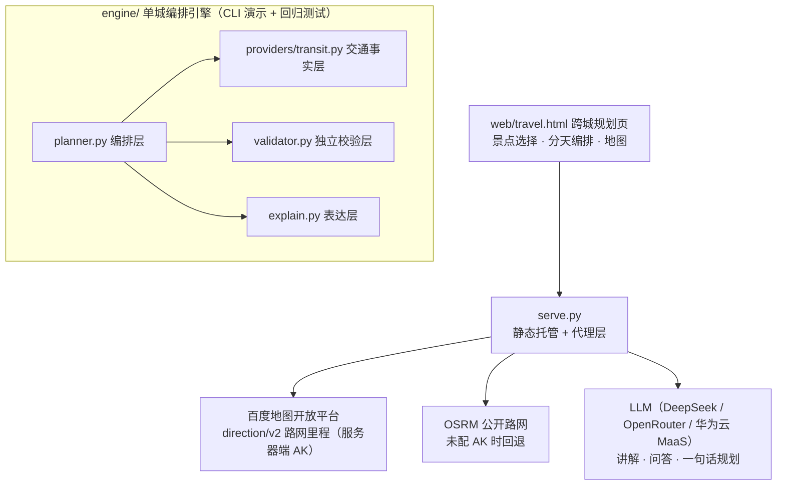

# ICT Itinerary Engine · 可执行行程编排引擎

[](https://github.com/Rylin512/ict-itinerary-engine/actions/workflows/ci.yml)


把一组景点和约束（天数、同行人、节奏、预算、出发日）排成一份**真正走得完**的行程：每个点几点到、待多久、坐几号线、从哪个口出、走多少米、几点收工，并由独立校验器重推时间轴确认可行性。

> 华为 ICT 创新赛（2026—2027）赛题一「基于华为云产品打造 AI 创新应用」参赛原型。Web 产品为**跨城出行规划页**（全国地级市），单城编排引擎保留为 Python 命令行演示。

## 目录

- [项目简介](#项目简介)
- [功能特性](#功能特性)
- [系统架构](#系统架构)
- [快速开始](#快速开始)
- [API 接口](#api-接口)
- [项目结构](#项目结构)
- [关键设计](#关键设计)
- [开发与 CI](#开发与-ci)
- [数据说明](#数据说明)
- [路线图](#路线图)
- [已知限制](#已知限制)
- [文档](#文档)
- [许可证](#许可证)

## 项目简介

小红书提供地点灵感，百度地图提供单段路线，本项目实现两者之间的**行程编排层**：

- **输入**：用户勾选的景点，以及天数、同行人、节奏、预算、出发日等约束；
- **处理**：在开放时间、最短停留、午餐窗、每日结束时间、步行上限、预算等硬约束下完成分天、排序与时间推进；
- **输出**：出口级的可执行行程、独立校验结果，以及排不下时明确的取舍说明。

设计原则是：**地图 API 是事实，求解器是决策，LLM 是表达**，三者不能互相替代。大模型只负责听懂人话和说人话；单段路怎么走必须来自地图接口，一天怎么排必须来自约束求解。

## 功能特性

| 能力 | 说明 |
|---|---|
| 跨城出行规划（Web 主产品） | 全国 339 个地级行政区可选（含港澳，不含台湾）；41 城深度收录 304 个景点，按 🔥热门 / 💰性价比 / 🌿冷门 / 🧭待探索 四级分类；出发/返程时间段可选（精确到时刻，自动压缩首尾两天游玩窗口）；**行程按天分组**——地理聚类分天 + 容量平衡 + 每天独立最优排序，逐段通勤方式可切换、支持跨天挪动；交通落位到具体机场/高铁站 + 接驳估算 + 分城打车计价（`travel.html`） |
| AI 能力 | DeepSeek / OpenRouter / 华为云 MaaS 等通道：一句话生成行程、行程讲解（只转述结构化事实）、目的地攻略问答（`ai.js` + `serve.py /api/llm`） |
| 需求 → 行程（引擎，CLI 演示） | 修改天数、同行人、节奏、预算或出发日，立即重新求解；原型实测约 12 ms（`run_demo.py`） |
| 选点即算代价（引擎） | 勾选或取消一个景点，返回交通时间、步行距离、车费变化；约 5 ms |
| 出口级描述（引擎） | 「2 号线往一品天下方向 2 站 → 从 B 口出站，步行 150 米」 |
| 时间可行性（引擎） | 独立校验器从 09:00 重推时间轴，不依赖编排器的自述；回归测试 0 违规 |
| 排不下会说明（引擎） | 不硬塞景点，明确告知舍弃了什么以及可选的替代方案 |
| 局部重排（引擎） | 某天下雨时只重排该天，其余天保持不变 |

## 系统架构



各层的真实化路径：

| 当前实现 | 生产环境替换为 | 替换位置 |
|---|---|---|
| 成都地铁示意网络、模拟公交 | 高德 / 百度公交路径规划 API | `providers/transit.py` 的 `route()` |
| 贪心 + 2-opt 排序 | 华为云 OptVerse 天筹求解器（VRP-TW） | `planner.py` 的 `_best_order()` |
| 模板生成文案 | 华为云 MaaS（盘古 / DeepSeek） | `explain.py` |

接口按真实数据的形状设计，替换实现时调用方无需改动。详见[技术设计文档](docs/技术设计-行程编排.md)。

## 快速开始

### 环境要求

- Python 3.10 及以上
- 无第三方依赖，仅使用 Python 标准库

### 启动 Web 演示

```bash
git clone https://github.com/Rylin512/ict-itinerary-engine.git
cd ict-itinerary-engine/prototype
python serve.py
```

浏览器打开 <http://127.0.0.1:8765>（自动跳转到跨城规划页 `/travel.html`）。默认端口为 8765，被占用时自动顺延，也可通过 `--port` 指定。

局域网内用手机访问：

```bash
python serve.py --host 0.0.0.0
```

可选增强：设置环境变量 `BAIDU_MAP_AK`（服务器端 AK）后打车/接驳里程来自百度真实路网；设置 `BAIDU_BROWSER_AK`（浏览器端 AK）后底图自动切换为百度地图 JS API GL，无需在页面里粘贴。两个 AK 均受 **2 次/秒**上限约束：服务端 `baidu_gate()` 做全局节流，前端 `BAIDU.enqueue()` 串行排队，突发请求会排队执行而不是直接报错。

### 命令行演示

```bash
cd prototype
python run_demo.py
```

依次运行生成、校验、边际成本、局部重排、随机压测与接口示例六段演示。

### 运行测试

```bash
cd prototype
python -m unittest discover -s tests -t . -v
```

## API 接口

serve.py 现在只承载**代理层**（跨城页完全前端化，编排引擎走命令行）：

| 方法 | 路径 | 说明 |
|---|---|---|
| GET | `/api/ai-config` | 本地可用的 LLM 渠道探测（key 只报有无，不回传内容） |
| POST | `/api/llm` | OpenAI 兼容 LLM 代理（解决浏览器 CORS 与 key 不落盘） |
| GET | `/api/baidu-config` | 百度 AK 探测（服务器端就绪状态 + 浏览器端 AK） |
| POST | `/api/baidu/place` | 百度地点检索（酒店 / 景点，返回出入口坐标） |
| POST | `/api/baidu/suggest` | 百度地点输入提示（模糊搜索，返回候选列表供用户选择） |
| POST | `/api/baidu/detail` | 百度地点详情（按 uid 取 `navi_location` 真实出入口） |
| POST | `/api/baidu/route` | 百度多模式路线（driving/walking/riding/transit，返回真实折线） |
| POST | `/api/baidu/driving` | 兼容旧接口：驾车路线（同样返回折线） |
| GET | `/api/tiles/{z}/{x}/{y}.png` | 高德瓦片代理（OSM 不可达时的底图兜底） |

LLM 请求体：`{baseURL, model, messages, temperature?, max_tokens?}`，key 经请求头 `X-Api-Key` 或对应环境变量提供；百度地点检索请求体 `{query, region, pageSize}`，模糊搜索 `{query, region}`，详情 `{uid}`，路线 `{from:[lng,lat], to:[lng,lat], mode, city1?, city2?}`（GCJ-02，公交需城市名），key 经 `X-Baidu-Ak` 或 `BAIDU_MAP_AK`。所有百度上游调用共用 0.55s 全局闸门（≤2 QPS）；地点检索/模糊搜索/详情走优先队列，不会被批量路线请求堵住。上游域名白名单见 `serve.py`（可用 `LLM_ALLOWED_HOSTS` 追加）。

## 项目结构

```text
.
├── .github/workflows/ci.yml     CI：lint / test / build
├── docs/
│   ├── 方案蓝图.md              赛题解读、产品定位、华为云选型、12 周计划
│   └── 技术设计-行程编排.md      分层职责、约束建模、行程 JSON、验收标准
├── prototype/
│   ├── serve.py                 静态托管跨城页 + LLM/百度代理
│   ├── run_demo.py              命令行演示（单城编排引擎）
│   ├── web/                     跨城规划页（travel.html + travel.js/data/css/guides + ai.js + baidu.js）
│   ├── engine/                  编排引擎
│   │   ├── models.py            数据模型（时间统一为整数分钟）
│   │   ├── planner.py           编排层：分天、排序、时间推进、增量重算
│   │   ├── validator.py         独立校验层
│   │   ├── explain.py           表达层
│   │   ├── serialize.py         前端 JSON 契约
│   │   ├── providers/transit.py 交通事实层
│   │   └── data/                成都景点与地铁示意数据
│   └── tests/                   引擎回归 + 代理单测（LLM / 百度）
├── ruff.toml                    lint 规则
└── README.md
```

## 关键设计

- **时间统一用整数分钟**：`09:00` 存储为 `540`，避免 `datetime` 与时区在跨天计算中引入问题，仅在展示时格式化。
- **三层解耦**：交通事实层、编排求解层、表达层各自独立；换数据源不影响算法，换模型不影响调度。
- **先可行，再最优**：开放时间、闭馆日、最短停留、午餐窗、每日结束时间、步行上限与预算均为硬约束；排不下时按满意度从低到高舍弃，并把舍弃原因写给用户。
- **增量重算**：勾选景点时只做插入或替换，不重排其余天，这是「选点即算代价」能在毫秒级返回的前提。
- **独立校验**：校验器不复用编排器的判断，从每日 09:00 重推时间轴；测试中会故意改坏一条行程，确认校验器确实能发现问题。

## 开发与 CI

CI 工作流位于 [`.github/workflows/ci.yml`](.github/workflows/ci.yml)，在 push 和 Pull Request 到 `main` 时运行：

| 检查 | 内容 |
|---|---|
| `lint` | `ruff check prototype`，规则见 `ruff.toml` |
| `test` | `python -m unittest discover -s tests -t . -v` |
| `build` | 编译 Python 源码、校验 JSON 数据、打包原型 zip 并上传 artifact |

`main` 分支已开启保护：

- 禁止直接推送，必须新建分支并通过 Pull Request 合并；
- 合并前必须通过 `lint`、`test`、`build` 三项检查，且分支需与 `main` 保持同步；
- 不要求人工 approve；
- 管理员同样受上述规则约束。

本地提交前建议执行：

```bash
ruff check prototype
cd prototype && python -m unittest discover -s tests -t . -v
```

## 数据说明

按「事实 / 估算 / 演示」三档诚实标注（答辩可自证没有编数据）：

| 数据 | 档位 | 来源 | 位置 |
|---|---|---|---|
| 成都地铁骨架、出口距离 | 示意 | 人工整理 | `engine/data/*.json` |
| 景点池（41 城 300+ POI，坐标/票价/备注） | 事实（近似） | 公开信息整理，标注来源 | `web/travel-data.js` |
| 车站 / 机场表（41 城机场 + 高铁站，坐标/枢纽/接驳备注） | 事实（近似） | 公开资料整理，updated 2026-10 | `web/travel-data.js` `STATIONS` |
| 出租车计价表（18 城起步价/单价/远途费） | 事实（会浮动） | 各市发改委/交通部门公开信息，updated 2026-10 | `web/travel-data.js` `TAXI_TARIFF` |
| 打车里程与时长 | 估算 | **百度地图开放平台 direction/v2**（服务器端 AK，经 serve.py 代理）→ 未配 AK 时回退 OSRM 公开路网 → 直线×1.35 | `web/baidu.js` + `serve.py /api/baidu/driving` |
| 城际时间/票价、公交地铁接驳 | 估算 | 距离启发式公式 | `web/travel.js` |
| 目的地攻略（美食/住宿/避坑/灵感） | 演示 | 2026-10 联网检索公开攻略整理，逐条标注来源 | `web/travel-guides.js` |
| AI 讲解 / 问答 / 一句话规划 | 实时 | DeepSeek/OpenRouter/华为云 MaaS 等 OpenAI 兼容接口，只许转述结构化事实；离线演示通道兜底 | `web/ai.js` + `serve.py /api/llm` |

说明：**滴滴 / 哈罗 / 小红书 / 携程 / 同程 / 抖音均无公开免费 API**（需企业签约），原型中分别以「出租车计价表 + 百度路网/OSRM」「本地攻略库 + LLM 检索问答」替代，并预留 `RideHailingProvider` / `GuideProvider` 适配位，拿到资质后换实现不动 UI。

**百度地图开放平台接入（双 AK）**：① 服务器端 AK（Web 服务 API）配在 serve.py 环境变量 `BAIDU_MAP_AK`（或设置面板粘贴，经请求头 `X-Baidu-Ak` 传给本地代理），用于驾车路线规划取真实里程/时长；② 浏览器端 AK（JS API GL）在设置面板粘贴后，地图展示层由 OSM 切换为原生百度地图（坐标经 GCJ-02→BD-09 闭合公式转换）。导航跳转一律走百度地图 URI API（免 AK）。两类 AK 都不写进代码仓库。单城页公交路径规划接入时替换 `engine/providers/transit.py` 的 `route()`，调用方无需改动。

## 路线图

- [ ] 接入百度公交路径规划（direction/v2/transit），统计字段完整率
- [ ] 将 `_best_order()` 替换为华为云 OptVerse 天筹求解器（VRP-TW）
- [ ] `explain.py` 接入 MaaS，并增加「只许转述、不许编造站名」的约束测试
- [ ] 鸿蒙 ArkTS 多端前端（手机 / 平板 / PC 2in1）

## 已知限制

- 排队与人流未建模，仅按固定停留时长计算；
- 午餐固定 60 分钟，地点取上一站附近，未接入真实餐厅数据；
- 仅支持单城、单酒店，未考虑换酒店与跨城交通；
- 出口库仅覆盖 14 个成都景点，扩展全国需按高频站点覆盖；
- 无实时公交与延误数据，等车时间按「发车间隔 / 2」估算；
- 雨天重排只会补充同城室内备选，不会跨天调整行程。

## 文档

- [方案蓝图](docs/方案蓝图.md)：赛题解读、产品定位、华为云选型、12 周计划、答辩脚本
- [技术设计 · 行程编排](docs/技术设计-行程编排.md)：三层职责、数据源矩阵、约束建模、行程 JSON、验收标准
- [原型说明](prototype/README.md)：运行方式、演示内容、实测数据、已知不足

## 许可证

本仓库为比赛作品展示，未附开源许可证，默认保留所有权利；未经许可请勿直接搬运或商用。
