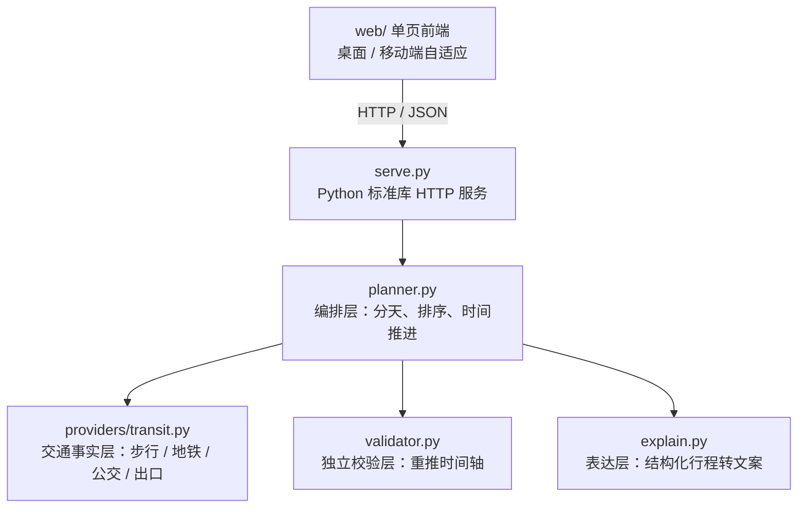

# ICT Itinerary Engine · 可执行行程编排引擎

[](https://github.com/Rylin512/ict-itinerary-engine/actions/workflows/ci.yml)


把一组景点和约束（天数、同行人、节奏、预算、出发日）排成一份**真正走得完**的行程：每个点几点到、待多久、坐几号线、从哪个口出、走多少米、几点收工，并由独立校验器重推时间轴确认可行性。

> 华为 ICT 创新赛（2026—2027）赛题一「基于华为云产品打造 AI 创新应用」参赛原型，当前为成都单城演示。

<p align="center">
  
  
</p>

## 目录

- [项目简介](#项目简介)
- [功能特性](#功能特性)
- [系统架构](#系统架构)
- [快速开始](#快速开始)
- [API 接口](#api-接口)
- [项目结构](#项目结构)
- [关键设计](#关键设计)
- [开发与 CI](#开发与-ci)
- [数据说明](#数据说明)
- [路线图](#路线图)
- [已知限制](#已知限制)
- [文档](#文档)
- [许可证](#许可证)

## 项目简介

小红书提供地点灵感，高德提供单段路线，本项目实现两者之间的**行程编排层**：

- **输入**：用户勾选的景点，以及天数、同行人、节奏、预算、出发日等约束；
- **处理**：在开放时间、最短停留、午餐窗、每日结束时间、步行上限、预算等硬约束下完成分天、排序与时间推进；
- **输出**：出口级的可执行行程、独立校验结果，以及排不下时明确的取舍说明。

设计原则是：**地图 API 是事实，求解器是决策，LLM 是表达**，三者不能互相替代。大模型只负责听懂人话和说人话；单段路怎么走必须来自地图接口，一天怎么排必须来自约束求解。

## 功能特性

| 能力 | 说明 |
|---|---|
| 需求 → 行程 | 修改天数、同行人、节奏、预算或出发日，立即重新求解；原型实测约 12 ms |
| 选点即算代价 | 勾选或取消一个景点，返回交通时间、步行距离、车费变化；约 5 ms |
| 出口级描述 | 「2 号线往一品天下方向 2 站 → 从 B 口出站，步行 150 米」 |
| 时间可行性 | 独立校验器从 09:00 重推时间轴，不依赖编排器的自述；回归测试 0 违规 |
| 排不下会说明 | 不硬塞景点，明确告知舍弃了什么以及可选的替代方案 |
| 局部重排 | 某天下雨时只重排该天，其余天保持不变 |
| 跨城出行规划 | 全国 339 个地级行政区可选（含港澳，不含台湾）；41 城深度收录 304 个景点，按 🔥热门 / 💰性价比 / 🌿冷门 / 🧭待探索 四级分类；城际交通对比、地图选点、三种排序方案、逐段通勤方式切换（`travel.html` + `travel-data.js`） |

## 系统架构



各层的真实化路径：

| 当前实现 | 生产环境替换为 | 替换位置 |
|---|---|---|
| 成都地铁示意网络、模拟公交 | 高德 / 百度公交路径规划 API | `providers/transit.py` 的 `route()` |
| 贪心 + 2-opt 排序 | 华为云 OptVerse 天筹求解器（VRP-TW） | `planner.py` 的 `_best_order()` |
| 模板生成文案 | 华为云 MaaS（盘古 / DeepSeek） | `explain.py` |

接口按真实数据的形状设计，替换实现时调用方无需改动。详见[技术设计文档](docs/技术设计-行程编排.md)。

## 快速开始

### 环境要求

- Python 3.10 及以上
- 无第三方依赖，仅使用 Python 标准库

### 启动 Web 演示

```bash
git clone https://github.com/Rylin512/ict-itinerary-engine.git
cd ict-itinerary-engine/prototype
python serve.py
```

浏览器打开 <http://127.0.0.1:8765>。默认端口为 8765，被占用时自动顺延，也可通过 `--port` 指定。

局域网内用手机访问：

```bash
python serve.py --host 0.0.0.0
```

跨城出行规划页：<http://127.0.0.1:8765/travel.html>——出发地/目的地覆盖全国地级市；41 个城市深度收录（含小红书热门点位：泉州蟳埔簪花、阿那亚孤独图书馆、榕江村超、阿勒泰、景德镇陶溪川等），景点分四级，其余城市可查交通并推荐最近可规划城市。

### 命令行演示

```bash
cd prototype
python run_demo.py
```

依次运行生成、校验、边际成本、局部重排、随机压测与接口示例六段演示。

### 运行测试

```bash
cd prototype
python -m unittest discover -s tests -t . -v
```

## API 接口

| 方法 | 路径 | 说明 |
|---|---|---|
| GET | `/api/meta` | 景点池与默认参数 |
| POST | `/api/plan` | 生成整份行程 |
| POST | `/api/toggle` | 勾选或取消一个景点，返回新行程与代价 diff |
| POST | `/api/replan` | 局部重排某一天（例如雨天） |

`/api/plan` 请求示例：

```bash
curl -s -X POST http://127.0.0.1:8765/api/plan \
  -H 'Content-Type: application/json' \
  -d '{
    "ids": ["kuanzhai", "wuhou", "jinli", "jinsha"],
    "days": 2,
    "party": "老人",
    "pace": "标准",
    "budget": 1500,
    "start_weekday": 6
  }'
```

通用请求字段：

| 字段 | 类型 | 说明 |
|---|---|---|
| `ids` | `string[]` | 景点 ID 列表，可从 `/api/meta` 获取 |
| `days` | `int` | 天数，1–5，默认 3 |
| `party` | `string` | 同行人：`成人` / `老人` / `带娃` |
| `pace` | `string` | 节奏：`轻松` / `标准` / `紧凑` |
| `budget` | `number` | 预算（元） |
| `start_weekday` | `int` | 出发日，1=周一 … 7=周日 |

`/api/toggle` 额外接收 `pid`（景点 ID）；`/api/replan` 额外接收 `day`（第几天）与 `mode`（默认 `rain`）。响应包含 `trip`（行程 JSON）和 `violations`（独立校验违规列表）。

## 项目结构

```text
.
├── .github/workflows/ci.yml     CI：lint / test / build
├── docs/
│   ├── 方案蓝图.md              赛题解读、产品定位、华为云选型、12 周计划
│   └── 技术设计-行程编排.md      分层职责、约束建模、行程 JSON、验收标准
├── prototype/
│   ├── serve.py                 HTTP 服务 + 四个 JSON 接口
│   ├── run_demo.py              命令行演示
│   ├── web/                     前端页面（单城编排 index.html；跨城规划 travel.html）
│   ├── engine/                  编排引擎
│   │   ├── models.py            数据模型（时间统一为整数分钟）
│   │   ├── planner.py           编排层：分天、排序、时间推进、增量重算
│   │   ├── validator.py         独立校验层
│   │   ├── explain.py           表达层
│   │   ├── serialize.py         前端 JSON 契约
│   │   ├── providers/transit.py 交通事实层
│   │   └── data/                成都景点与地铁示意数据
│   └── tests/test_engine.py     回归测试（含 HTTP 契约测试）
├── ruff.toml                    lint 规则
└── README.md
```

## 关键设计

- **时间统一用整数分钟**：`09:00` 存储为 `540`，避免 `datetime` 与时区在跨天计算中引入问题，仅在展示时格式化。
- **三层解耦**：交通事实层、编排求解层、表达层各自独立；换数据源不影响算法，换模型不影响调度。
- **先可行，再最优**：开放时间、闭馆日、最短停留、午餐窗、每日结束时间、步行上限与预算均为硬约束；排不下时按满意度从低到高舍弃，并把舍弃原因写给用户。
- **增量重算**：勾选景点时只做插入或替换，不重排其余天，这是「选点即算代价」能在毫秒级返回的前提。
- **独立校验**：校验器不复用编排器的判断，从每日 09:00 重推时间轴；测试中会故意改坏一条行程，确认校验器确实能发现问题。

## 开发与 CI

CI 工作流位于 [`.github/workflows/ci.yml`](.github/workflows/ci.yml)，在 push 和 Pull Request 到 `main` 时运行：

| 检查 | 内容 |
|---|---|
| `lint` | `ruff check prototype`，规则见 `ruff.toml` |
| `test` | `python -m unittest discover -s tests -t . -v` |
| `build` | 编译 Python 源码、校验 JSON 数据、打包原型 zip 并上传 artifact |

`main` 分支已开启保护：

- 禁止直接推送，必须新建分支并通过 Pull Request 合并；
- 合并前必须通过 `lint`、`test`、`build` 三项检查，且分支需与 `main` 保持同步；
- 不要求人工 approve；
- 管理员同样受上述规则约束。

本地提交前建议执行：

```bash
ruff check prototype
cd prototype && python -m unittest discover -s tests -t . -v
```

## 数据说明

成都地铁 1/2/3/4/7 号线骨架、`1024路（示意）` 与出口距离均为**示意数据**，用于验证算法与交互；景点开放时间与票价按公开信息整理。接入真实地图开放平台后，只需替换 `engine/providers/transit.py` 的 `route()`，调用方无需改动。

## 路线图

- [ ] 接入高德 / 百度公交路径规划，统计字段完整率
- [ ] 将 `_best_order()` 替换为华为云 OptVerse 天筹求解器（VRP-TW）
- [ ] `explain.py` 接入 MaaS，并增加「只许转述、不许编造站名」的约束测试
- [ ] 鸿蒙 ArkTS 多端前端（手机 / 平板 / PC 2in1）

## 已知限制

- 排队与人流未建模，仅按固定停留时长计算；
- 午餐固定 60 分钟，地点取上一站附近，未接入真实餐厅数据；
- 仅支持单城、单酒店，未考虑换酒店与跨城交通；
- 出口库仅覆盖 14 个成都景点，扩展全国需按高频站点覆盖；
- 无实时公交与延误数据，等车时间按「发车间隔 / 2」估算；
- 雨天重排只会补充同城室内备选，不会跨天调整行程。

## 文档

- [方案蓝图](docs/方案蓝图.md)：赛题解读、产品定位、华为云选型、12 周计划、答辩脚本
- [技术设计 · 行程编排](docs/技术设计-行程编排.md)：三层职责、数据源矩阵、约束建模、行程 JSON、验收标准
- [原型说明](prototype/README.md)：运行方式、演示内容、实测数据、已知不足

## 许可证

本仓库为比赛作品展示，未附开源许可证，默认保留所有权利；未经许可请勿直接搬运或商用。
