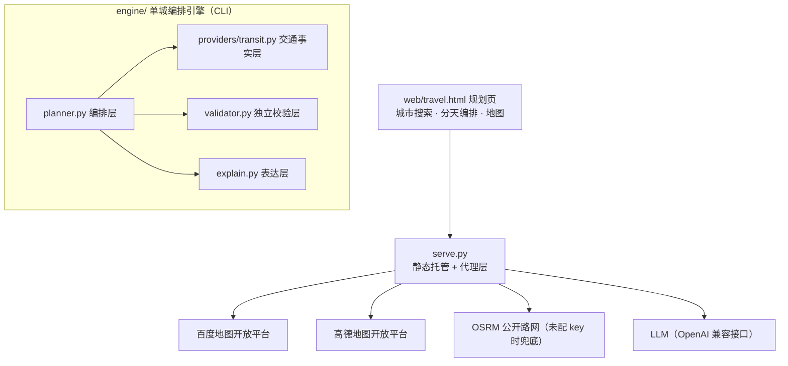

# Itinerary Engine · 行程编排引擎

把「从哪出发、去哪、玩几天、和谁、预算多少」变成一份**真正走得完**的行程：
哪天到哪、几点走、坐什么、在哪换乘、每处待多久，以及一份可以照着走的路线图。

Web 端是一个跨城出行规划页（全国地级市 / 港澳），Python 端是一套可独立运行的行程编排引擎，
两边共用同一套「约束 + 时间推进 + 校验」的设计。

## 功能

| 模块 | 说明 |
|---|---|
| 城市搜索 | 出发地 / 目的地支持输入过滤（全国 300+ 地级行政区），回车直接选中，不用翻列表 |
| 城际交通 | 高铁 / 飞机 / 普速按距离估算，落位到具体车站与机场，可选上下车站、接驳方式与出发点 |
| 市内行程 | 地理聚类分天 + 每天独立排序，逐段可选步行 / 骑行 / 公交 / 打车，支持跨天挪动 |
| 路线图 | Leaflet（OSM / 高德瓦片）与百度 GL、高德 JS API 三套展示后端，按可用性自动选择 |
| 酒店与接驳 | 目的地酒店模糊搜索，选中后按酒店实际出入口计算首末段 |
| 目的地情报 | 美食 / 住宿 / 避坑 / 灵感，逐条标注来源；未收录城市可走 AI 生成 |
| AI 助手 | 一句话生成行程、行程讲解、目的地问答；只转述结构化数据，不编造站点 |
| 离线兜底 | 断网时地图降级、AI 走离线演示通道，页面仍可完整演示 |
| 本地缓存 | 地点 / 路线结果持久化到本机，超出体积上限按使用频率清理 |

## 双地图供应商

百度与高德两套开放平台都被接成了可切换的供应商，用来摊薄单家配额、并在某一家限流时自动降级。

```
路线规划  → 百度优先，失败切高德
地点检索  → 高德优先，失败切百度
自动模式  → 每次请求轮换起始供应商
```

地图工具栏的「路网」按钮点一下即可在 **自动 / 百度 / 高德** 之间切换；设置面板里还能按能力
分别指定（路线走百度、搜索走高德等），任一项指定后按钮显示「自定义」。

两侧各有独立节流（百度 550 ms、高德 340 ms），并发请求在闸门前排队，不会因为突发流量触发限流。

## 快速开始

```bash
git clone https://github.com/Rylin512/itinerary-engine.git
cd itinerary-engine/prototype
python serve.py
```

浏览器打开 <http://127.0.0.1:8765>，会自动跳转到规划页。端口被占用时自动顺延，也可 `--port` 指定。

手机同一 WiFi 访问：

```bash
python serve.py --host 0.0.0.0
```

只依赖 Python 标准库，不需要 `pip install`。

### 可选配置

通过环境变量启用外部服务（不配置时全部走免费兜底）：

| 变量 | 作用 |
|---|---|
| `BAIDU_MAP_AK` / `BAIDU_BROWSER_AK` | 百度服务端 / 浏览器端 AK |
| `AMAP_MAP_KEY` / `AMAP_BROWSER_KEY` | 高德服务端 / 浏览器端 Key |
| `DEEPSEEK_API_KEY`、`OPENROUTER_API_KEY`、`SILICONFLOW_API_KEY`、`HUAWEI_MAAS_API_KEY` | 任选其一启用 AI（OpenAI 兼容接口） |
| `LLM_API_KEY` | 通用兜底 key |
| `AMAP_MIN_INTERVAL` | 高德节流间隔（秒，默认 0.34） |

密钥只从环境变量读取，不会写入仓库；页面上的「AI 设置」面板也可以临时填 key（只存本机浏览器）。

## 架构



设计原则：**地图 API 是事实，求解器是决策，LLM 是表达**，三者不互相替代。
单段路怎么走来自地图接口，一天怎么排来自约束求解，模型只负责把结构化结果讲成人话。

## 目录

```text
prototype/
├── serve.py              静态托管 + 地图/LLM 代理（标准库，无依赖）
├── run_demo.py           单城引擎命令行演示
├── web/
│   ├── travel.html       跨城规划页
│   ├── travel.js         页面逻辑（分天、路线、地图抽象层）
│   ├── travel-data.js    城市 / 景点 / 车站 / 计价数据
│   ├── travel-guides.js  目的地情报
│   ├── maps.js           地图供应商路由 + 高德 JS API 加载
│   ├── baidu.js          百度适配层 + 免费数据兜底
│   ├── ai.js             AI 通道层
│   └── vendor/leaflet/   本地 Leaflet（断网可用）
├── engine/
│   ├── models.py         数据模型（时间统一为整数分钟）
│   ├── planner.py        分天、排序、时间推进、增量重算
│   ├── validator.py      独立校验层
│   ├── explain.py        结构化结果转自然语言
│   └── providers/        交通事实层（示意地铁网络）
└── tests/                引擎回归 + 代理单测
```

## 数据说明

按「事实 / 估算 / 演示」三档标注，避免把估算当成事实：

| 数据 | 档位 | 来源 |
|---|---|---|
| 城市、景点、车站与机场坐标 | 事实（近似） | 公开资料整理，标注更新月份 |
| 出租车计价 | 事实（会浮动） | 各市公开计价规则 |
| 打车里程与时长 | 估算 | 百度 / 高德路线规划；无 key 时 OSRM，再退回直线公式 |
| 城际时间、票价、公交接驳 | 估算 | 距离启发式 |
| 单城地铁 / 公交示意网络 | 示意 | 人工整理，仅用于引擎演示 |
| 目的地情报 | 演示 | 公开攻略整理，逐条标注来源 |

## 开发

```bash
cd prototype
python -m unittest discover -s tests -t . -v   # 测试
ruff check .                                    # 静态检查（CI 使用）

python run_demo.py                              # 引擎演示
```

CI 在每次 push / PR 到 `main` 时运行 lint、test、build 三项检查。

## 已知限制

- 排队与人流未建模，按固定停留时长计算；
- 午餐固定 60 分钟，取上一站附近，未接真实餐厅数据；
- 单城引擎只覆盖成都示意网络，扩展全国需补站点与线路数据；
- 城际时长与票价是估算，接入票务 API 后替换；
- 打车、公交依赖第三方开放平台，配额受限时自动降级到免费路网。

## 许可证

未附开源许可证，默认保留所有权利；未经许可请勿直接搬运或商用。
