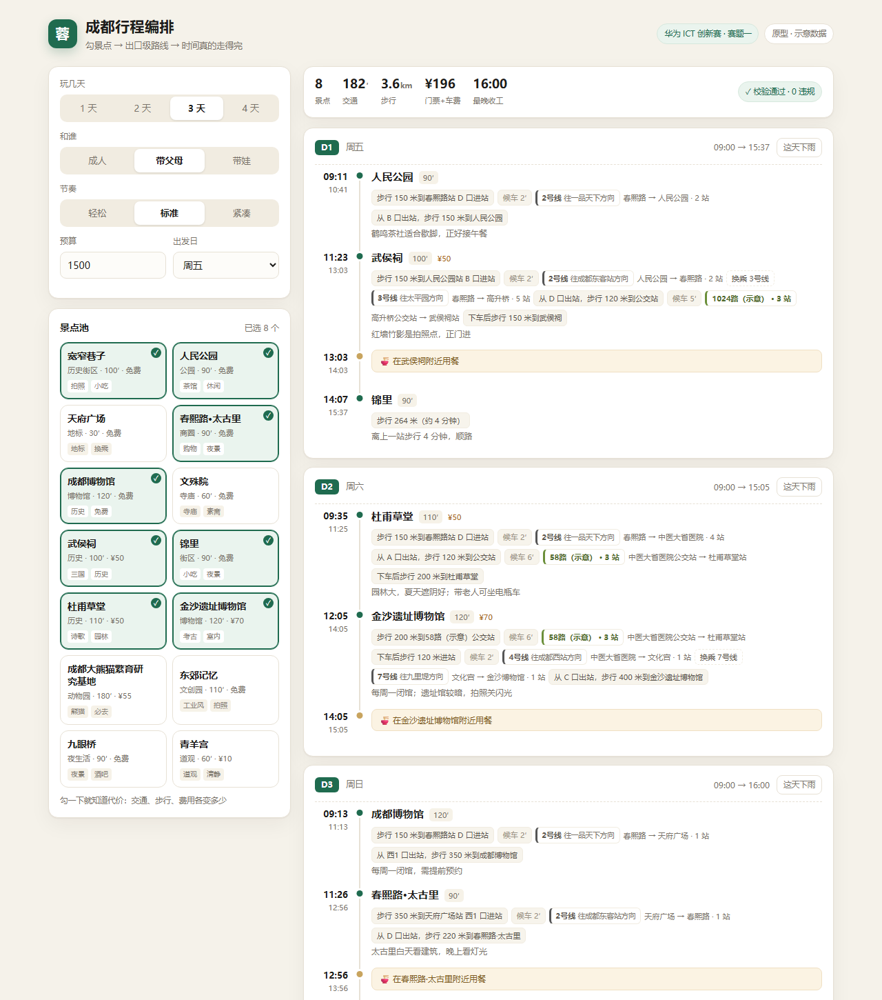
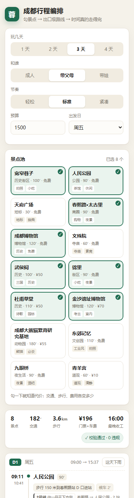

# 行程编排引擎 · Python 原型（成都）

一条链路跑通了：**勾景点 → 立刻看到代价 → 出口级行程 → 某天下雨只改那天**。
3 天 8 个点全量求解约 12 ms，勾一个景点的代价计算约 5 ms。纯标准库，不装任何东西。

## 一、跑起来

### 网页版（手机 + 电脑，推荐演示用）

```bash
cd prototype
python serve.py                     # 打开 http://127.0.0.1:8765
python serve.py --host 0.0.0.0      # 手机同一 WiFi：http://<你的IP>:8765
```

另一个入口：**`http://127.0.0.1:8765/travel.html` —— 跨城出行规划页**（`web/travel.html + travel.js + travel.css`，独立于上面的单城编排页）。流程：出发地/目的地 → 交通方式对比（飞机/高铁/普速/自驾/大巴，含时间价格估算与"大多数人选择"标记）→ 地图上勾选景点分布 → 三种排序方案（系统推荐=最省时、大众经典、自定义）+ 每段通勤方式可切换（步行/骑行/公交地铁/打车）→ Leaflet 地图画线 + 高德导航跳转雏形。内置 6 个城市示意数据，成都 14 个景点与本引擎同源，接真实 API 时只需替换 `travel.js` 里的 `intercityOptions / legOpts` 两个估算函数。





四个交互，正好对应答辩的四句话：

1. **改需求就重排**：天数 / 同行人 / 节奏 / 预算 / 出发日，任意一项变化立刻重新求解。
2. **勾景点看代价**：底部浮出「＋青羊宫 · 交通 +34 分钟 · 步行 +1300 米 · 车费 +4 元」，约 5 ms 返回。
3. **某天下雨**：只重排那一天，户外点换成室内点，其余两天一个点都不动。
4. **右上角绿色徽章**："✓ 校验通过 · 0 违规"——独立校验器从 09:00 重推一遍时间轴算出来的，不是编排器自己说的。

接口（前端只认这四个）：

| 方法 | 路径 | 作用 |
|---|---|---|
| GET | `/api/meta` | 景点池 + 默认参数 |
| POST | `/api/plan` | 生成整份行程 |
| POST | `/api/toggle` | 勾选/取消一个点，返回新行程 + 代价 diff |
| POST | `/api/replan` | 某一天下雨，局部重排 |

### 命令行版

```bash
python run_demo.py                                # 六个演示一次跑完
python -m unittest discover -s tests -t . -v      # 5 条回归测试
```

---

## 二、它到底证明了什么

| 想证明的 | 怎么证明 | 结果 |
|---|---|---|
| 行程在时间上真的可行 | 独立校验器重推时间轴 | 0 违规（30 组随机输入同样 0 违规） |
| 描述能到出口级 | 输出里出现"从 B 口出站，步行 180 米" | 见上面截图 |
| 勾一个点立刻知道代价 | 增量插入 + diff | 4—5 ms，返回交通/步行/费用/收工时间变化 |
| 扰动只改局部 | 锁住其余两天，只重排第 2 天 | 第 1、3 天完全不变 |
| 排不下会说实话 | 松弛时记录"牺牲了什么" | 第 1 天明确告知杜甫草堂放不进 |

最后一条是重点：**能排 8 个就绝不硬塞第 9 个。** 评委问"凭什么说你的行程可执行"，现场改个参数、跑一次校验，比嘴上说强。

---

## 三、目录

```
prototype/
├─ serve.py                       最小 HTTP 服务（标准库）：静态页 + 四个 JSON 接口
├─ run_demo.py                    命令行演示：生成 / 校验 / 边际成本 / 重排 / 压测 / 接口示例
├─ web/
│  ├─ index.html                  单页界面
│  ├─ app.js                      交互逻辑（无框架）
│  └─ style.css                   响应式样式（≤1039px 自动切单列，手机可用）
├─ engine/
│  ├─ models.py                   数据模型（时间统一用「当天第几分钟」整数）
│  ├─ providers/transit.py        交通事实层：步行 + 地铁 + 公交 + 出口（成都示意网络）
│  ├─ planner.py                  编排层：分天、求序、时间推进、松弛、增量重算
│  ├─ validator.py                独立校验层：重推时间轴，查硬约束
│  ├─ explain.py                  表达层（模板版）：结构化 leg → 人话
│  ├─ serialize.py                Trip → 前端 JSON 契约
│  └─ data/                       14 个成都景点 + 地铁 1/2/3/4/7 号线骨架
└─ tests/test_engine.py           5 条回归测试（含 HTTP 契约测试）
```

---

## 四、三个关键设计（答辩可以直接用）

### 1. 时间一律用整数

`09:00` 存成 `540`。编排里天天做加减比较，用 `datetime` 只会引入时区和跨天 bug。展示时才 `fmt()` 转回去。

### 2. 三层解耦，谁也别越界

```
transit.py   回答：这段路怎么走、多少米、多少分钟    ← 将来换高德 API
planner.py   回答：先去哪后去哪、每个点待多久、够不够  ← 自研，求解器在这层
explain.py   回答：怎么讲给用户听                    ← 将来换 LLM
```

好处：换数据源不动算法，换模型不动调度。评委问"大模型在这里干什么"，答案很干脆——**只干表达，不干事实。**

### 3. 先可行，再最优；松弛必须报账

求解不是"算个最短路径"，是带时间窗和一堆硬约束的排序：

- 开放时间 / 闭馆日 / 停止入场
- 时间推进：`到达 = 上一站离开 + 路程`
- 最短停留（景点不能只待 10 分钟）
- 午餐窗（11:30—14:30 之间安排 60 分钟）
- 每日结束时间、步行上限、预算
- 排不下就按满意度从低到高舍弃，**并且把舍弃原因写出来**

### 4. 增量重算，不是每次全量重排

勾一个景点时，只把它插到某一天里试位置（或替换掉当天一个更低分的点），其余天原封不动。所以 4—5 ms 出结果——这是"选点即算代价"这个交互能成立的前提。

---

## 五、现在哪些是假的，怎么换成真的

| 现在 | 真实产品 | 换哪里 |
|---|---|---|
| 成都地铁示意网络、`1024路（示意）` | 高德/百度公交路径规划 API | `providers/transit.py` 的 `route()`，返回结构不用改 |
| 贪心 + 2-opt | 华为云 OptVerse 天筹求解器（VRP-TW） | `planner.py` 的 `_best_order()`，输入输出结构不变 |
| 模板生成文案 | 华为云 MaaS（盘古/DeepSeek） | `explain.py`，喂同一个 leg 结构 + "不许新增事实" |
| 14 个景点、5 条地铁线 | 一城 300—500 个 POI | `data/*.json` |

接口是照真实数据的形状设计的，换实现不用改调用方。

---

## 六、实测数据（i5 笔记本，纯 Python）

| 场景 | 耗时 |
|---|---|
| 3 天 8 点全量求解 | 12 ms |
| 随机 3—9 点 × 30 次平均 | 3 ms |
| 勾选一个点的边际成本（含 HTTP） | 4—5 ms |
| 30 组随机输入硬约束违规 | 0 |

真实 API 一接，耗时主要花在网络请求上，所以真实产品里必须做**路程矩阵缓存**（见方案蓝图 3.6）。

---

## 七、已知不足（别在答辩里被问住）

- **排队/人流**没建模，只按固定停留时长算；真实产品要用分时热度。
- **午餐**固定 60 分钟、地点是"上一站附近"，没有真实餐厅数据。
- **只有单城、单酒店**，没有考虑换酒店、跨城交通。
- **出口库只有 14 个点覆盖**，全国扩展需要按高频站点覆盖（80/20）。
- **没有实时公交/延误**，等车时间用的是"发车间隔/2"。
- **雨天重排**只会补同城室内备选，不会跨天挪行程。

---

## 八、下一步

1. 接一个真实地图 API，跑 20 组起终点，统计字段完整率（**这件事先做**，不通过就改方案）。
2. 把 `_best_order` 换成 OptVerse，10 个点带时间窗，记录求解时间。
3. 给 `explain.py` 接 MaaS，做"只许转述"的约束测试（拿 50 条 leg 生成文案，抽查有没有编造站名）。
4. 再用鸿蒙 ArkTS 把前端接上——接口契约见 `run_demo.py` 第 ⑥ 段输出的 JSON。
